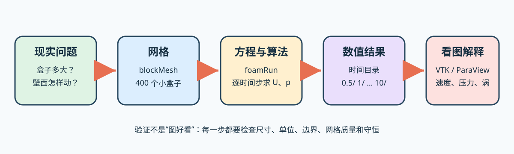

# 第 0 课：OpenFOAM 到底在算什么

这一课不运行程序。目标是让你不用术语，也能向同学解释 OpenFOAM 的工作。

## 0.1 从一杯水开始

想象一杯水。水里任意位置都有速度和压力，但我们不可能询问无限多个位置。计算机采用一个
笨但有效的办法：把空间切成有限多个小盒子，只在每个小盒子里保存少量数值。

这就是 **网格（mesh）**。每个小盒子叫 **控制体（control volume/cell）**。OpenFOAM 的
核心方法叫有限体积法：对每个控制体记账——从各个面流进多少质量、流出多少质量，动量增加
还是减少。所有小盒子的账同时算平，便得到下一时刻的速度和压力。

你现在不需要推导方程，只需记住：

> CFD 不是拍摄流体，而是在很多小盒子上反复做守恒记账。

## 0.2 方腔流是怎样的实验

我们先研究一个 `0.1 m × 0.1 m` 的正方形截面：

```text
              上盖向右运动，U=(1,0,0) m/s
        ┌────────────────────────→┐
        │                          │
        │       流体被拖动         │
静止墙  │        ↙   ↘             │  静止墙
        │       ↘  ○  ↙            │
        │                          │
        └──────────────────────────┘
                    静止墙
```

上盖附近的流体受黏性作用向右运动；它不能穿出右墙，只能向下转弯，最终形成顺时针大涡。
这和用手掌贴着水面向右推水相似。

这个算例其实有一格厚度 `0.01 m`，前后两个面设为 `empty`，告诉 OpenFOAM：“忽略厚度方向
的变化，把它当二维问题。”二维并不等于文件里没有第三个坐标。

## 0.3 五个必须会说人话的词

| 术语 | 大白话 | 方腔流中的例子 |
|---|---|---|
| 几何（geometry） | 要研究的物体或空间形状 | 0.1 m 的方盒 |
| 网格（mesh） | 把空间切成的小盒子集合 | 20×20×1，共 400 个 cell |
| 场（field） | 空间每个位置都有的量 | 速度 `U`、运动压力 `p` |
| 边界条件 | 边界上必须遵守的规则 | 上壁速度 1 m/s，其他墙速度 0 |
| 求解器（solver） | 用方程和算法更新每个 cell 的程序 | `foamRun` 加载 `incompressibleFluid` |

`U` 是向量，写成 `(Ux Uy Uz)`；`p` 是标量，只有一个数。速度不能只说“5”，还必须说明
方向；压力不需要方向。

## 0.4 “场”不是一个总数

室外温度不是整个城市只有一个数，而是每个地点都有自己的温度。速度场也是如此：

```text
cell 0: U=(0.01,  0.00, 0)
cell 1: U=(0.03, -0.01, 0)
cell 2: U=(0.08, -0.02, 0)
...
```

OpenFOAM 的 `0/U` 不是只存三个速度数；它定义全部 cell 的初始速度，以及每个边界 patch
应遵守的速度规则。求解后，`10/U` 保存 `t=10 s` 时的速度场。

## 0.5 一次计算的数据怎样流动



逐箭头解释：

1. 先把现实问题说清楚：尺寸、单位、流体、壁面怎样运动；
2. `blockMesh` 读取 `blockMeshDict`，把几何切成控制体；
3. `foamRun` 读取网格、初值、边界、物性和算法设置；
4. 程序一步一步产生 `0.5/`、`1/`……`10/` 的数值快照；
5. ParaView 或 Python 把数值变成颜色、箭头和流线。

图片在最后，物理和单位在最前。漂亮图片不能挽救错误的单位或边界条件。

## 0.6 OpenFOAM 为什么不像普通软件

OpenFOAM 是一套命令行程序和 C++ 库，不是一个单独的图形软件。一个算例就是一个目录，
文字字典决定实验。好处是每项设置都能审查、复制和版本控制；代价是你必须知道文件放在哪里。

本教程使用 **OpenFOAM Foundation v14**。网上还有 OpenCFD/ESI 发行版，版本号类似
`v2412`。二者同源但命令、求解器名和字典会有差异。看到教程时先问：“它针对哪个发行版？”

## 0.7 单位：程序不会替你猜

本教程使用一致的 SI 单位：m、s、m/s。OpenFOAM 会检查量纲组合，却不知道你心里把数字
`10` 当成 10 m、10 cm 还是 10°。地形经纬度的单位是角度，不能直接作为局部 CFD 的米。

## 费曼检查：合上上文回答

1. 为什么 CFD 要把空间切成许多 cell？
2. 网格和几何有什么区别？
3. 为什么速度 `U` 是场，而不是一个速度数？
4. 方腔流的涡为什么会出现？
5. `foamRun` 之前为什么必须先有网格和边界条件？

参考答案只看关键词：**有限记账点；形状与切分；每处不同；上壁黏性拖动且墙面封闭；程序
需要知道在哪算以及边界遵守什么规则**。不能用自己的话补成完整句子，就再读对应小节。
