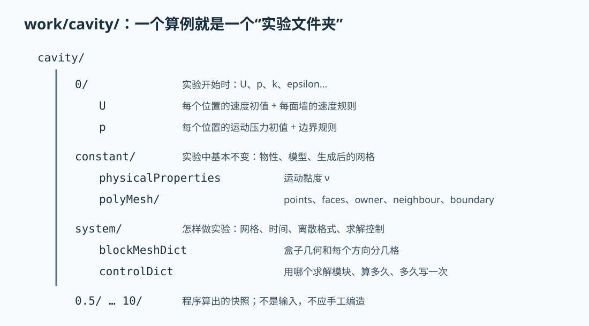

# 第 3 课：逐层拆开一个 OpenFOAM 算例

把算例想成一份实验报告：`0/` 写实验开始的状态，`constant/` 写物性和设备，`system/` 写
实验步骤，数字目录是仪器在不同时间拍下的快照。



## 3.1 先打印真实目录树

在仓库根目录运行：

```bash
find work/cavity -maxdepth 2 -type f | sort | sed -n '1,80p'
```

核心输入结构是：

```text
work/cavity/
├── 0/
│   ├── U
│   ├── p
│   ├── k
│   ├── epsilon
│   ├── omega
│   ├── nuTilda
│   └── nut
├── constant/
│   ├── physicalProperties
│   ├── momentumTransport
│   └── polyMesh/                 # blockMesh 运行后生成
└── system/
    ├── blockMeshDict
    ├── controlDict
    ├── fvSchemes
    └── fvSolution
```

为什么 `0/` 里同时有多种湍流变量？官方教学模板允许切换不同湍流模型。当前
`momentumTransport` 选择哪种模型，就读取相应字段；不是每个文件都会同时参与求解。

## 3.2 读 `0/U`：一个文件同时回答“开始怎样”和“墙上怎样”

```bash
sed -n '1,180p' work/cavity/0/U
```

抓住四块：

```foam
dimensions      [0 1 -1 0 0 0 0];
internalField   uniform (0 0 0);
boundaryField
{
    movingWall { type fixedValue; value uniform (1 0 0); }
    fixedWalls { type noSlip; }
    frontAndBack { type empty; }
}
```

- `[0 1 -1 0 0 0 0]` 是量纲指数，表示长度¹/时间¹，即 m/s；
- `internalField` 说 `t=0` 时内部流体静止；
- `movingWall` 强制上壁速度为 `(1,0,0)` m/s；
- `noSlip` 表示流体贴着静止墙时速度为零；
- `empty` 表示该方向不求变化，用于一层厚的二维算例。

边界名字必须和 `constant/polyMesh/boundary` 中完全一致。改成 `topWall` 却不改网格 patch，
不是“意思差不多”，而是找不到边界。

## 3.3 读 `0/p`：为什么压力单位不是 Pa

```bash
sed -n '1,150p' work/cavity/0/p
```

不可压缩求解常使用运动压力 `p/ρ`，量纲是 m²/s²。因此图上的 `p=0.02` 不是 0.02 Pa。
若密度是 `ρ=1000 kg/m³`，对应静压差才是 `1000×0.02=20 Pa`。绝对压力还需要参考值；
封闭不可压缩流动主要由压力梯度驱动，给整个压力场加同一常数不会改变速度。

## 3.4 读 `constant/physicalProperties`：流体有多“黏”

```bash
cat work/cavity/constant/physicalProperties
```

重点是运动黏度 `nu`。黏度越大，速度差越容易被抹平；黏度越小，惯性相对越重要。单位由
文件中的量纲给出，不要只复制数字。

用顶盖速度 `U=1 m/s`、边长 `L=0.1 m` 和运动黏度 `ν` 可组成雷诺数：

```text
Re = U L / ν
```

Re 没有单位，衡量惯性与黏性的相对强弱。先从文件读出 `ν`，自己算一次 Re；不要从网上
抄一个“方腔流常用 Re”。

## 3.5 读 `system/blockMeshDict`：顶点、块和边界

```bash
sed -n '1,240p' work/cavity/system/blockMeshDict
```

你会看到：

- `vertices`：8 个角点；
- `blocks`：一个六面体以及 `(20 20 1)` 的分格数；
- `boundary`：哪些外表面组成 `movingWall/fixedWalls/frontAndBack`；
- `scale 0.1`：文件内坐标整体乘 0.1。因此顶点写 `1`，实际是 0.1 m。

这是新手最容易漏掉的地方。只看顶点数值而不看 `scale`，会把 10 cm 的盒子误认成 1 m。

## 3.6 读 `system/controlDict`：总导演

```foam
solver          incompressibleFluid;
startTime       0;
endTime         10;
deltaT          0.005;
writeControl    timeStep;
writeInterval   100;
```

翻译：用不可压缩流体模块，从 0 s 算到 10 s，每步 0.005 s，每 100 步写一次结果。改变
`writeInterval` 只改变磁盘快照频率，不改变内部每一步怎样推进。

## 3.7 `fvSchemes` 和 `fvSolution` 不要混为一谈

- `fvSchemes` 决定微分项怎样变成网格上的代数近似，好比“用什么公式近似斜率”；
- `fvSolution` 决定产生的代数方程怎样迭代求解、容差多严，好比“怎样把联立方程解出来”。

初学阶段先使用官方配置。修改它们不是调一个“精度旋钮”；不同格式会影响稳定性、耗散和
有界性，必须配合网格与时间步做验证。

## 3.8 一个安全实验：只缩短结束时间

```bash
cp -a work/cavity work/cavity_experiment
foamDictionary work/cavity_experiment/system/controlDict \
    -entry endTime -set 0.2
foamRun -case work/cavity_experiment
foamListTimes -case work/cavity_experiment
```

`foamDictionary` 理解 OpenFOAM 字典，比盲目文本替换可靠。观察只出现到 0.2 s 的结果，再用
下面命令确认原算例仍是 10 s：

```bash
foamDictionary work/cavity/system/controlDict -entry endTime -value
```

## 费曼检查

1. 为什么 `0/U` 既有 `internalField` 又有 `boundaryField`？
2. `scale 0.1` 对几何做了什么？
3. `deltaT` 和 `writeInterval` 分别控制什么？
4. `fvSchemes` 与 `fvSolution` 的分工是什么？
5. 为什么运动压力不能直接读成 Pa？
