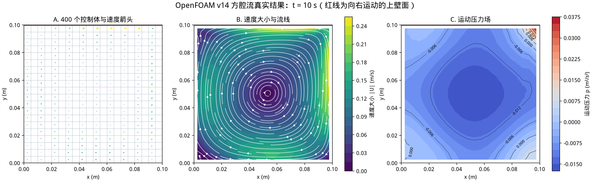

# 第 4 课：并行运行与 ParaView

把 400 份作业分给 4 位同学：每人做 100 份，但交界处的答案必须互相交换。这就是域分解
并行。MPI rank 是独立进程，不是网格，也不是线程。

## 并行的四步

```bash
source ./env.sh
NP=4 ./run_cavity_parallel.sh
```

脚本执行：

```text
blockMesh -> decomposePar -> mpirun foamRun -parallel -> reconstructPar
```

`decomposePar` 产生 `processor0/` 等子域；MPI 每个 rank 计算一个子域；`reconstructPar`
把分散结果重构成普通时间目录。进程数必须与 `numberOfSubdomains` 一致，脚本会自动修改。

方腔算例太小，并行反而可能更慢；它只用于学习流程。真正的大网格才会受益。

## 四步分别留下什么

```text
work/cavity_parallel/
├── 0/ constant/ system/      # 完整原始算例
├── processor0/               # rank 0 的网格和局部字段
├── processor1/               # rank 1 的网格和局部字段
├── processor2/
├── processor3/
├── 0.5/ 1/ ... 10/           # reconstructPar 重构后的完整结果
├── log.decomposePar
├── log.foamRun.parallel
└── log.reconstructPar
```

`system/decomposeParDict` 的 `numberOfSubdomains 4` 必须与 `mpirun -np 4` 相同。`method
scotch` 表示让 Scotch 根据 cell 邻接关系自动分区，目标是每份 cell 数接近且交界面较少。

看分区摘要：

```bash
grep -E 'Processor [0-9]|Number of cells|Max number' \
    work/cavity_parallel/log.decomposePar
```

本案例每个 rank 得到 100 个 cell。进程之间还要交换交界面的速度和压力，所以并行不是免费
加速：计算量太小时，通信和启动开销反而更大。

`reconstructPar` 像把四个人分别写的答卷重新按题号拼回一份。ParaView 通常打开重构后的
完整结果最简单。若忘了重构，结果仍在 `processor*/` 中，并非“计算结果消失”。

## 可视化

本机已安装 ParaView 时：

```bash
paraFoam -case work/cavity
```

如果 `paraFoam` 找不到 ParaView，可直接生成标记文件：

```bash
touch work/cavity/cavity.foam
paraview work/cavity/cavity.foam
```

在 ParaView 中点击 **Apply**，选择 `U`，用 Slice 查看中间截面，再用 Glyph 或 Stream Tracer
查看速度方向。远程服务器通常没有图形桌面，可把算例重构结果复制到本机 ParaView 打开，或用
ParaView 的 client/server 模式。

ParaView 操作与物理量对应：

1. `Surface With Edges`：先确认网格，而不是先看颜色；
2. Coloring 选 `U`，再选 `Magnitude`：颜色显示速度大小；
3. Glyph：箭头显示向量方向，Scale Factor 太大只会让箭头更长，不会改变数据；
4. Stream Tracer：流线展示瞬时速度方向；
5. Coloring 选 `p`：查看运动压力，不要把数值直接标成 Pa。

无图形界面时按第 6 课用 `foamToVTK -ascii` 和 Matplotlib，结果如下：



## 费曼检查

1. 4 个 MPI rank 和 400 个 cell 是什么关系？
2. 为什么小算例并行可能更慢？
3. `processor0/` 为什么既有网格又有字段？
4. `reconstructPar` 做了什么，没有它结果还在不在？
5. ParaView 中放大箭头为什么不等于速度变大？
