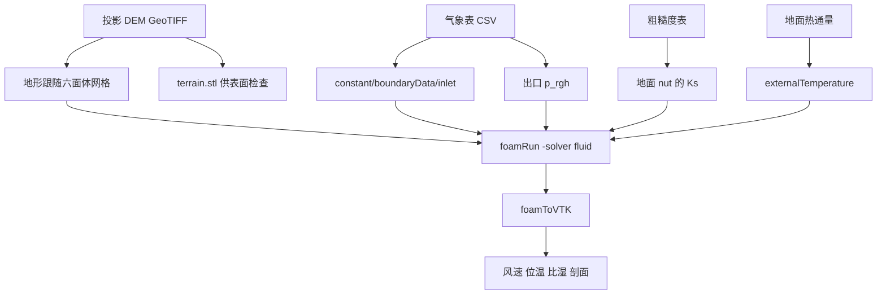
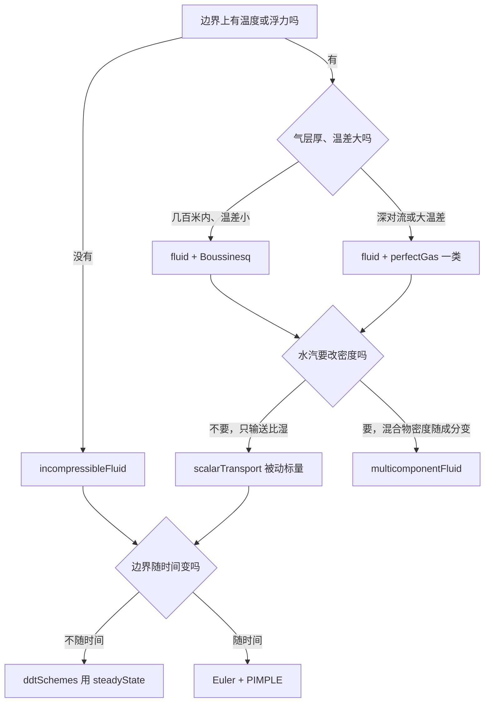
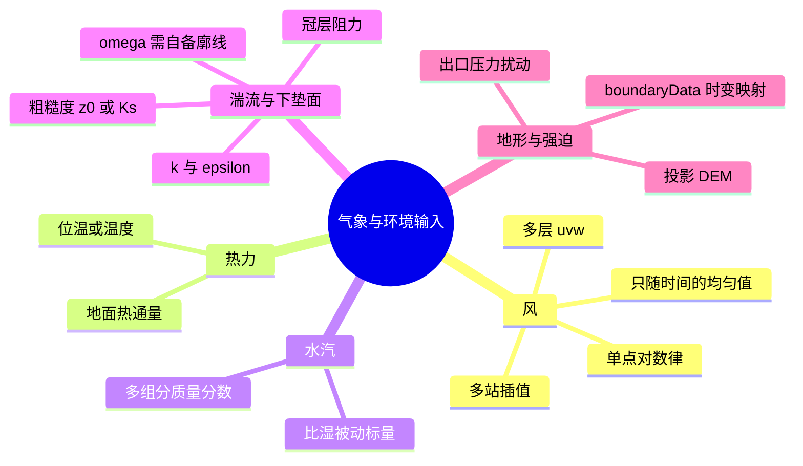
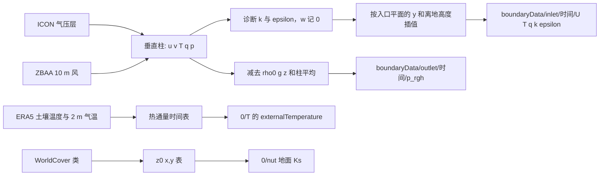
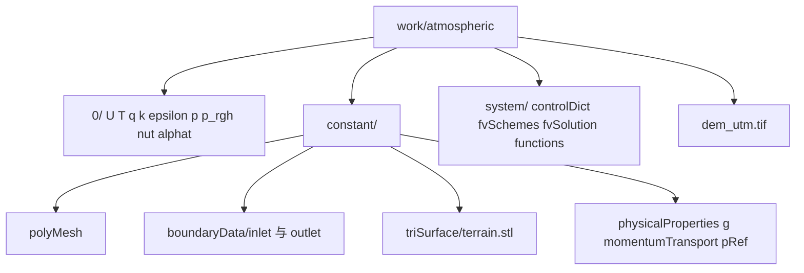

# 第 5 课：把地形和气象表送进 OpenFOAM

这一课的算例是北京景山。范围在 `download_dem.sh` 的示例框里，北纬 39.85° 到 39.95°、东经 116.30° 到 116.45°，从中取大约 720 m × 480 m 的 Copernicus GLO-30。地面高程大约 44 m 到 85 m。入口给 2025-01-15 凌晨三个时刻的多层风和位温，比湿和湍流写在同一张表里。地面给 WorldCover 转成的粗糙度，热通量由 ERA5 地面量估算。求解用 OpenFOAM v14 的 `fluid` 模块，算 20 s。

网格、边界和初始场由 `./prepare_atmospheric.sh` 写到 `work/atmospheric/`。那个目录在 `.gitignore` 里。DEM、STL 和各时刻结果都不进 Git。仓库里留下这次取回的气象表、粗糙度表和脚本，以及这一课的结果图。



## 5.1 先认准这一版的求解器名字

`install_openfoam.sh` 固定的是 OpenFOAM Foundation v14，补丁标签 `20261008`。这一版的求解器是模块，由 `foamRun -solver <模块名>` 启动。

| 老命令 | v14 实际执行 |
|---|---|
| `simpleFoam`、`pimpleFoam` | `foamRun -solver incompressibleFluid` |
| `buoyantFoam`、`rhoSimpleFoam`、`rhoPimpleFoam` | `foamRun -solver fluid` |
| `buoyantReactingFoam` | `foamRun -solver multicomponentFluid` |

标签里没有 `buoyantBoussinesqPimpleFoam` 这个程序。浮力用 `fluid`，密度关系写在 `constant/physicalProperties` 的 `equationOfState`。浅层、温差小，用 `Boussinesq`。温差大或气层厚，改成 `incompressiblePerfectGas` 或 `perfectGas`，求解器模块仍是 `fluid`。

稳态也是同一个模块。把 `system/fvSchemes` 的 `ddtSchemes` 改成 `steadyState`，并在 `fvSolution` 里加松弛，官方算例 `hotRoomBoussinesqSteady` 就是这样做的。时变边界不要走稳态。

`incompressibleFluid` 不求解温度。湿度、热通量和分层都要 `fluid`。



`multicomponentFluid` 能运水汽质量分数，混合物密度可以跟着变。它没有凝结，也不诊断相对湿度。本课的湿度走被动标量，不改密度。

## 5.2 大气算例最多能吃进什么

下面这张表只写 v14 这个标签里真有的接口。类型名用 Foundation 的拼写。`openfoam.com` 上的 `atmBoundaryLayerInletVelocity` 是另一支发行版，写进本仓库的算例会报找不到类型。这里对应的名字是 `atmosphericBoundaryLayerVelocity`。



| 输入 | 接到哪里 | 哪个求解器 | 限度 |
|---|---|---|---|
| 单点风速、风向、一个参考高度 | `constant/atmosphericBoundaryLayerProperties` 的 `Uref`、`Zref`、`z0`、`flowDir`、`zDir`。`0/U` 用 `atmosphericBoundaryLayerVelocity`，`0/k` 用 `atmosphericBoundaryLayerTurbulentKineticEnergy`，`0/epsilon` 用 `atmosphericBoundaryLayerTurbulentEpsilon`。需要 `libs ("libatmosphericModels.so");` | `incompressibleFluid` 或 `fluid` | 中性、干燥、水平均匀。风向不随高度变，`w = 0`。`k` 不随高度变，`epsilon` 按 `1/z`。没有配套的 omega 入口 |
| 多个测站 | 预处理插到 `constant/boundaryData/<patch>/points`，边界类型 `timeVaryingMappedFixedValue` | 任何把该量当固定值的求解器 | 不读气象站报文。默认 `mapMethod` 是平面三角插值，前三个点不能共线。点落在弯曲面上时改 `nearest` |
| 多层 `u,v,w` | 向量场 `U`。水平均匀且不随时间，可用 `fixedProfile`，沿 `direction` 查表 | `incompressibleFluid` 或 `fluid` | `fixedProfile` 不随时间变，也不随横向位置变。`w` 只是 `U` 的一个分量 |
| 只随时间、空间均匀的值 | `uniformFixedValue`，`uniformValue` 用 `Function1` 的 `table` | 同上 | 整个边界一个数 |
| 压力 | `fluid` 解 `p_rgh`（Pa）。`p` 由状态方程回算，边界多用 `calculated`。`incompressibleFluid` 的 `p` 是运动压力，单位 m²/s² | 见左 | 气象上的绝对气压不能直接写进 `p_rgh`。先减掉 `rho0*g*z`，再去掉整层平均，只留几帕的扰动。入口已固定 `U` 时，压力扰动放在出口 |
| 温度或位温 | 场名就是 `T`。入口用 `fixedValue`、`fixedProfile` 或 `timeVaryingMappedFixedValue` | `fluid` | 没有名叫 `theta` 的内建场。`Boussinesq` 把 `T-T0` 直接变成密度差，绝热递减率不会自动出现。浅层算例把位温写进 `T`，稳定层结是位温随高度增加 |
| 地面热通量 | `0/T` 的地面用 `externalTemperature`。`q` 是 W/m²，`Q` 是 W，也可给 `h` 和 `Ta`。都可以是随时间的 `Function1` | `fluid` | 正的 `q` 加进壁面热流，把热量送进流体。这不是大气辐射传输 |
| 比湿 | `system/functions` 里的 `scalarTransport`，本课场名 `q`。入口同样可以映射。扩散用 `alphal*nu + alphat*nut` | 跟速度场走，本课是 `fluid` | 被动标量，不改密度，不算相对湿度，没有凝结。相对湿度放在后处理里，由 `q`、`T`、`p` 诊断 |
| 水汽要参与密度 | `multicomponentFluid` 的组分质量分数 | `multicomponentFluid` | 仍没有凝结和相对湿度诊断。和本课的 `Boussinesq` 纯物质设置不是同一个算例 |
| `k`、`epsilon` | `constant/momentumTransport` 选 `kEpsilon` 或 `buoyantKEpsilon`。入口映射，或用上面的对数律边界 | 两个流体模块都可以 | ERA5 和这次用的 ICON 都不提供这两个量。对数律给出的 `k` 是常数。本课用最低层风速反推摩擦速度再诊断，写在边界表里 |
| `omega` | 湍流模型改 `kOmegaSST`，入口用 `fixedProfile` 或 `timeVaryingMappedFixedValue` 自己给 | 同上 | v14 的 `atmosphericModels` 没有 omega 入口，只有速度、`k`、`epsilon` 和壁面 `nut` |
| 粗糙度 `z0` | `nutAtmosphericBoundaryLayerWallFunction` 读取 `atmosphericBoundaryLayerProperties` 里的 `z0`。`z0` 是 `Function2`，可以随 `x,y` 变化。另一条路是 `nutkRoughWallFunction` 的 `Ks`、`Cs` | 用壁函数的 RAS | 不读土地利用栅格。`Ks` 大于第一层网格高度时，壁函数站不住。Hargreaves 建议 `Ks ≈ 20 z0` |
| 土地利用图 | 预处理成上面的 `z0` 或 `Ks`。本课读 `tutorial/data/beijing_landcover_z0.csv` | 同上 | 土地类型本身不是场 |
| 植被冠层阻力 | 孔隙模型 `powerLawLopesdaCosta`，湍流模型 `kEpsilonLopesdaCosta` | 通常配 `incompressibleFluid` | 这个湍流模型没有浮力生成项，不能和本课的 `buoyantKEpsilon` 同时用 |
| 地形 DEM | 投影到米之后，本课直接生成地形跟随网格。`tools/dem_to_stl.py` 仍可出 STL，再交给 `snappyHexMesh` | 与求解器无关，发生在求解之前 | 不读 GeoTIFF，也不接受经纬度当米。STL 不保存坐标系 |
| 时变再分析或数值预报 | `timeVaryingMappedFixedValue`。目录是 `constant/boundaryData/<patch>/points` 和 `<时间>/<场名>`。时间之间线性插值 | 场是固定值边界的求解器 | 不读 GRIB、NetCDF。ERA5 的垂直速度是 Pa/s，地面感热通量是累积的 J/m²，要先换算 |
| 科氏力 | 源码里没有现成的 Coriolis `fvModel`。大区域得自己写 `codedFvModel` | 动量方程 | 720 m 的域上这一项很小，本课没加 |
| 大气辐射 | `radiationModels` 里有 `P1`、`fvDOM`、`viewFactor`。`externalTemperature` 还可以加 `emissivity` | `fluid` | 这些是参与介质或面与面的辐射，不是 RRTM 那种气柱辐射，也不读太阳天顶角 |

对照这几个官方算例。

- `tutorials/incompressibleFluid/turbineSiting`：对数律和地形
- `tutorials/fluid/stackPlume`：`fluid` 模块，`Boussinesq`，`buoyantKEpsilon`，再加 `scalarTransport`
- `tutorials/incompressibleFluid/pitzDailySteadyExperimentalInlet`：`timeVaryingMappedFixedValue` 的文件格式
- `tutorials/fluid/roomHeating`：`externalTemperature`

## 5.3 本课实际接进去的量

表在 `tutorial/data/`。文件头写了来源、日期和位置。求解器时间的 0 s、10 s 和 20 s 对应 2025-01-15 00:00 UTC、01:00 UTC 和 02:00 UTC。一个小时的天气被压进 10 s，这 20 s 的积分并没有把那两个小时算完，只是让边界在三档实测廓线之间线性插值。

2026-10-23 核对过 Open-Meteo 的存档接口。`archive-api.open-meteo.com` 在 `models=era5` 下接受气压层变量名，返回值是空的。多层风、温度和湿度，以及位势高度，改从 Historical Forecast API 的 `icon_global` 读取，不需要 key。ERA5 在同一个存档里能给地面的 2 m 气温、10 m 风和 0–7 cm 土壤温度，热通量只用这三项。首都机场 ZBAA 的地面风来自 NOAA/IEM。

| 量 | 这次数值里有什么 | 算例里落在哪 |
|---|---|---|
| 两格点的 `u,v` | `beijing_boundary.csv`。南格点 39.875°N、116.375°E，北格点 40.000°N、116.375°E。高度含 2 m、10 m、100 m，以及 1000 hPa、975 hPa、950 hPa | 入口 `U`，`timeVaryingMappedFixedValue`。初始内场按离地高度铺同一张表 |
| `w` | 这个免费接口没有垂直速度，表里写 0 | `U` 的第三个分量 |
| 位温 | `T_K` 由绝对温度换成 1000 hPa 参考的位温。近地面约 263 K，180 m 内大约再升 3 K | 入口 `T` 和内场。`T0 = 290 K`，`beta = 1/T0`。冬夜的位温低于 `T0`，稳定度看的是位温随高度增加 |
| 比湿 | 由相对湿度、温度和气压换成 `q_kgkg`。近地面约 0.8 g/kg，往上减小 | 入口 `q`，`scalarTransport` 跟着 `U` 走 |
| `k`、`epsilon` | 用 2 m 以上最低一层的风速和 `z0 = 0.10 m` 做对数律诊断。`k` 不随高度变 | 入口 `k`、`epsilon`。地面仍是 `kqRWallFunction` 和 `epsilonWallFunction` |
| 绝对气压 | 地面约 1030 hPa，往上用气压层本身的压力 | `constant/pRef` 仍是 101325 Pa。出口 `p_rgh` 先减 `rho0*g*z` 和柱平均，再限制在 ±5 Pa。准备阶段会打印缩放警告 |
| 地面 10 m 风 | 00:00 UTC 和 01:00 UTC 用 ZBAA。风向 280° 和 220°，风速都是 5.83 kn，换成约 3.0 m/s。02:00 UTC 的 ZBAA 没有风向，这一档改回 ICON 的 10 m 风 | 写进 2 m 和 10 m 两层。2 m 的风速按 `z0 = 0.10 m` 从 10 m 对数外推 |
| ZBAA 气温 | `beijing_iem_zbaa.csv` 里有。测站在 40.0741°N、116.5870°E，离景山大约 24 km | 不写进 `T`。它比这条 ICON 气柱暖，换进去以后最低一层会不稳定 |
| 地面热通量 | `beijing_heatflux.csv`。由 ERA5 格点 40.0°N、116.5°E 的土壤温度、2 m 气温和 10 m 风估算，三档大约 22 W/m²、12 W/m² 和 2 W/m² | 地面 `externalTemperature` 的 `q` 表。ERA5 的 `sshf` 仍由文末的 CDS 脚本下载 |
| 粗糙度 | `beijing_landcover_z0.csv`，ESA WorldCover 2021 贴到 30 m 格点。林地 0.15 m，建成区 0.20 m，水体 0.001 m | 地面 `nutkRoughWallFunction` 的 `Ks = 20 z0`。建成区若按 1 m 的城市粗糙度，`Ks` 会超过第一层网格 |
| 地形 | Copernicus GLO-30，景山窗口，EPSG:32650 | `prepare_atmospheric.sh` 用 `gdalwarp` 裁到 `work/terrain/`，再读回来生成网格 |

南格点和北格点在 950 hPa 的风速差一截，入口沿 `y` 有水平变化。两个格点都在 720 m 的域外面，域内的值是它们之间的线性插值。原始 ICON 行在 `beijing_icon_levels.csv`。ERA5 地面行在 `beijing_era5_surface.csv`。ZBAA 报文在 `beijing_iem_zbaa.csv`。重新下载用 `python3 tools/fetch_openmeteo_boundary.py`。

要 ERA5 气压层的垂直速度和感热通量，用 `tools/fetch_era5_boundary.py`。额外依赖写在 `requirements-era5.txt`，包括 `cdsapi` 和 `netCDF4`，还有 `pyproj`。账号放在 `~/.cdsapirc`，不要写进命令行。必须自己给 `--epsg` 和 `--z0`，脚本不猜投影。垂直速度从 Pa/s 换成 m/s。`sshf` 是向下为正的累积焦耳每平方米，脚本把它变成进入空气的 W/m²，另外写成热通量表。`k` 和 `epsilon` 仍是诊断值。



## 5.4 地形仍然要从 DEM 来

山在文件里是一组高程。DEM 是高程模型的统称。DTM 尽量表示裸地，适合大气边界层。DSM 带上树顶和屋顶，30 m 的 DSM 不能当成建筑模型。

公开来源：

- [Copernicus DEM GLO-30/GLO-90](https://dataspace.copernicus.eu/explore-data/data-collections/copernicus-contributing-missions/collections-description/COP-DEM)，也有[公开 AWS COG 镜像](https://registry.opendata.aws/copernicus-dem/)
- [SRTM 1 Arc-Second Global](https://www.usgs.gov/faqs/where-can-i-get-global-elevation-data)
- [OpenTopography](https://opentopography.org/developers)，API 需要 key

本仓库的下载脚本走 OpenTopography。key 只放在环境变量里。

```bash
OPENTOPOGRAPHY_API_KEY=你的key ./download_dem.sh \
    39.85 39.95 116.30 116.45 work/terrain/dem_wgs84.tif
```

下载后的栅格是 WGS84 经纬度。先用 QGIS 或 Cartopy 核对海岸线和研究区。核对完再投影，OpenFOAM 只用米。

```bash
gdalwarp -t_srs EPSG:32650 -r bilinear -tr 30 30 \
    work/terrain/dem_wgs84.tif work/terrain/dem_utm.tif
```

投影会重算每个像元的位置。水平单位和垂直单位都要是 m，NoData 要先填上。脚本发现地理坐标系或旋转栅格会直接退出，不会自己挑一个 UTM 带。

本课的窗口不用 OpenTopography 的 key。`prepare_atmospheric.sh` 用公开的 Copernicus COG，裁 EPSG:32650 里的 `447420 4419180 448170 4419690`，像元 30 m，25 × 17 个节点。像元中心的西南角是东坐标 447435 m、北坐标 4419195 m，写在 `constant/terrainCase` 的 `originX`、`originY`。对应的经纬度大约是 39.921°N–39.926°N、116.385°E–116.394°E，景山主峰在局部坐标 `x ≈ 480 m`、`y ≈ 240 m`，高程 84.7 m。西边界高程只差大约 7 m，入口面比较直。网格从这份 GeoTIFF 读高程。换成你自己的投影 DEM 时：

```bash
./prepare_atmospheric.sh --dem work/terrain/dem_utm.tif --stride 4
```

`--stride` 每隔几个像元取一点。DEM 比网格细很多时，多出来的像元不会自动变成更可信的流场。

`tools/dem_to_stl.py` 会把同一份 GeoTIFF 写成 `constant/triSurface/terrain.stl`，并把西南角平移到局部 `(0,0)`。平移量记在 `constant/terrainCase` 的 `originX`、`originY`。STL 只有三角坐标，没有 CRS。它是开口的地形表面，`surfaceCheck` 可以看，适合做 `snappyHexMesh` 的贴体面。要做 CAD 布尔运算，还得自己封侧面和底。

本课求解用地形跟随六面体。入口是 `x = 0` 的平面，`timeVaryingMappedFixedValue` 的采样点铺在这张平面上，地面每个面的 `Ks` 也在写网格时一起写上。悬崖和建筑，以及要局部加密的情形，仍用 `snappyHexMesh`。背景盒包住地形，`locationInMesh` 放在空气里。先用低分辨率确认内外，再提高细化等级。每次都看 `checkMesh`。

## 5.5 算例目录



```text
work/atmospheric/
├── 0/
│   ├── U              # 入口 timeVaryingMappedFixedValue，地面 noSlip
│   ├── T              # 位温；地面 externalTemperature
│   ├── q              # 比湿
│   ├── k
│   ├── epsilon
│   ├── p_rgh          # 出口为映射来的扰动，其余 fixedFluxPressure
│   ├── p              # calculated，初始 101325 Pa
│   ├── nut            # 地面 nutkRoughWallFunction；polyMesh 里 ground 的 type 是 wall
│   └── alphat
├── constant/
│   ├── polyMesh/
│   ├── boundaryData/
│   │   ├── inlet/points
│   │   ├── inlet/0/U
│   │   └── outlet/0/p_rgh
│   ├── triSurface/terrain.stl
│   ├── physicalProperties
│   ├── momentumTransport      # buoyantKEpsilon
│   ├── g
│   ├── pRef
│   ├── atmosphericBoundaryLayerProperties   # 单点对数律备用，本课入口不用它
│   └── terrainCase            # 网格尺寸和 DEM 原点，求解器不读
├── system/
│   ├── controlDict            # solver fluid; endTime 20; deltaT 1
│   ├── fvSchemes
│   ├── fvSolution
│   ├── functions              # scalarTransport
│   └── scalarTransport
└── dem_utm.tif
```

`constant/atmosphericBoundaryLayerProperties` 留在算例里，是第 5.2 节那条单点对数律的现成字典。当前入口没有引用它，求解器不会去读。

单点对数律换成映射入口时，`0/U` 的入口是：

```text
inlet
{
    type            timeVaryingMappedFixedValue;
    offset          (0 0 0);
    setAverage      off;
    perturb         1e-5;
}
```

`offset` 的类型跟场一样。`U` 写向量 `(0 0 0)`。标量场写 `0`。`setAverage off` 时，时间目录里的场文件就是一个列表，没有单独的平均值行。格式和官方 `pitzDailySteadyExperimentalInlet` 一致。

## 5.6 运行

依赖和地形课相同：`numpy`、`rasterio`。画图还要 `matplotlib`。

```bash
python3 -m venv .venv
source .venv/bin/activate
python -m pip install -r requirements-terrain.txt -r requirements-post.txt

./prepare_atmospheric.sh
source ./env.sh
./run_atmospheric.sh
./plot_atmospheric.sh
```

`run_atmospheric.sh` 发现没有网格会先调用准备脚本。求解前会删掉大于 0 的时间目录。成功时日志里有 `Mesh OK`，求解以单独一行的 `End` 结束。

默认离散：水平 24 × 16 个格子，30 m；垂直 12 层，空气柱 180 m，近地第一层大约 8.4 m，增长率 1.10。一共 4608 个六面体。`endTime 20`，`deltaT 1`，写出 `10/` 和 `20/`。建成区 `Ks = 4 m`，水体 `Ks = 0.02 m`，都小于第一层高度。

这台机器上 `checkMesh` 的结论是 `Mesh OK`。最大非正交角 25.1°，平均 5.6°，最大偏斜度 0.60。包围盒从 (0 0 44) 到 (720 480 265)，单位 m。`foamRun` 积到 t = 20 时日志里的 `ExecutionTime` 是 0.60 s。t = 1 有一次 `bounding k`，最小值 -0.21，最大值 13.7。`20/k` 落在 0.054 到 7.1 m²/s²。

位温从地面到 180 m 大约升高 3 K。20 s 里大约 22 W/m² 的热通量在第一层里造成的升温大约 0.06 K，小于层结本身的层与层间隔。比湿只被风带走，不产生浮力。10 m 风速大约 3 m/s，20 s 里气块大约走 60 m，到不了 480 m 处的主峰。图上的风主要是初始廓线，加上这段时间里压力场对山体的调整。

结果图在第 6 课逐张解释。这里先放地形、网格和三个物理量，确认数据真的进了求解器。


## 5.7 这张表里有、本课没有接上的东西

- **科氏力**。v14 没有现成 fvModel。720 m 的域上可以先不算。
- **omega 的对数律入口**。要 `kOmegaSST` 就得自己写廓线。本课用 `buoyantKEpsilon`，因为浮力生成项和现成的大气 `k`、`epsilon` 边界是一套。
- **冠层体积阻力**。`kEpsilonLopesdaCosta` 和 `buoyantKEpsilon` 不能一起选。
- **相对湿度和凝结**。比湿是被动标量。相对湿度如果要画，用后处理由 `q`、`T` 和 `p` 算出。
- **水汽对密度的影响**。那是 `multicomponentFluid` 的另一类算例。
- **GRIB/NetCDF 直接进边界**。中间必须经过 `boundaryData`。
- **大气辐射传输和太阳位置**。地面热通量是已经折算好的 W/m²。
- **`snappyHexMesh` 贴体**。STL 会生成，这一课的求解网格没有走贴体。建筑和陡崖再换那条路。

## 费曼检查

1. 为什么 `simpleFoam` 这条命令还在，却不能拿来算这一课的温度？
2. `Boussinesq` 的 `T` 为什么要填位温，而不是按 9.8 K/km 把绝对温度写成上冷下热？
3. ERA5 的地面气压大约 10⁵ Pa。为什么出口 `p_rgh` 只有几帕？
4. 比湿 `q` 和 `externalTemperature` 里的 `q` 各是什么？
5. 两座测站怎样变成入口面上的一块 `U`？
6. 这份 DEM 已经是 EPSG:32650，为什么 STL 自己仍说不出这个 EPSG？
7. 建成区的空气动力粗糙度常常接近 1 m。这里为什么写成 0.20 m，又为什么要求第一层网格比 `Ks` 高？
