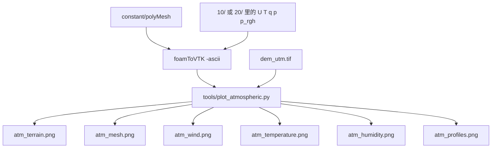
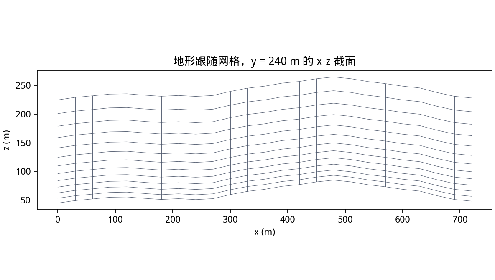
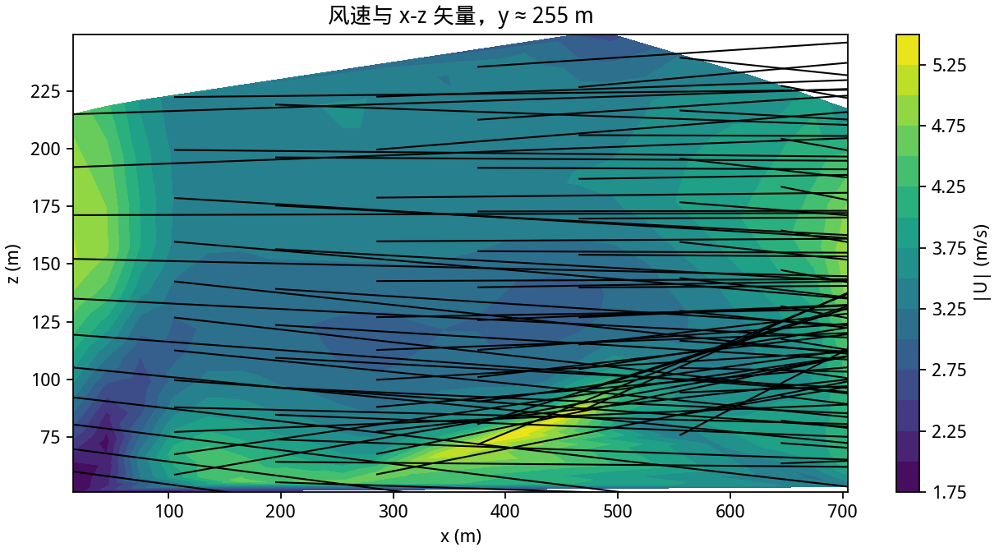
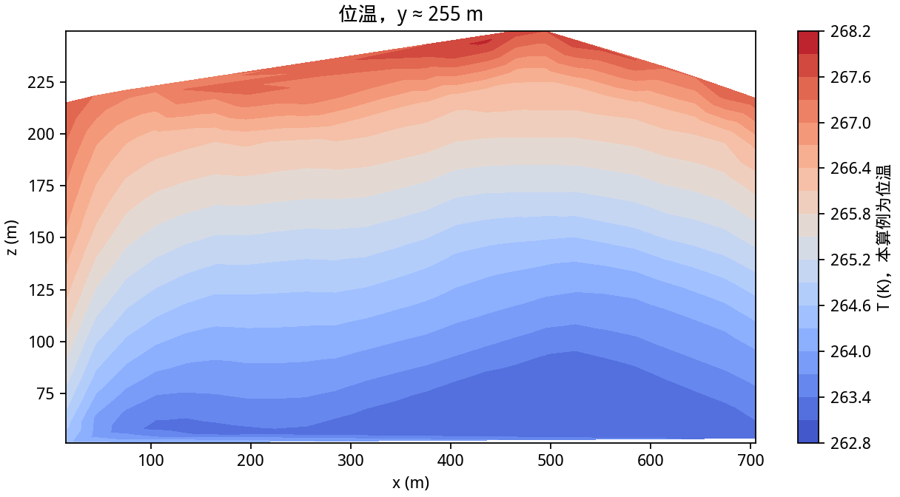
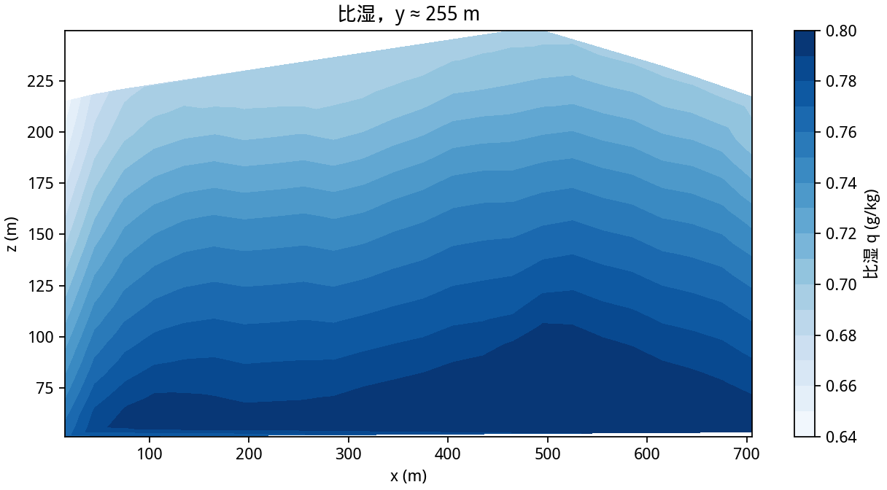
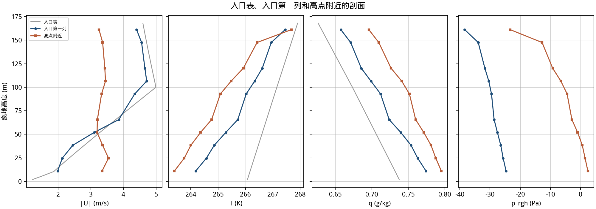

# 第 6 课：把大气算例和方腔流画出来

这一课用 `foamToVTK -ascii` 把网格和场合成一个 VTK，再用 Matplotlib 画图。大气算例的图在 `tutorial/images/atm_*.png`。方腔流仍用原来的 `plot_cavity.py`，给第 2 课和第 4 课留底。



坐标已经是局部米。Cartopy 用在第 5 课核对经纬度下载范围。投影之后的 DEM、STL 和 OpenFOAM 结果都不要再送进 Cartopy。

| 数据 | 坐标 | 工具 |
|---|---|---|
| 方腔、地形风场 | 局部 x y z，单位 m | ParaView、Matplotlib |
| 刚下载的 DEM | 经纬度，单位 ° | Cartopy、QGIS、Rasterio |
| 投影后的 DEM | 东、北坐标，单位 m | QGIS、Matplotlib、ParaView |

## 6.1 安装画图环境

```bash
python3 -m venv .venv
source .venv/bin/activate
python -m pip install -r requirements-post.txt -r requirements-terrain.txt
```

求解本身不需要这套包。`rasterio` 只为读取 `dem_utm.tif`。

## 6.2 地形和网格

`./plot_atmospheric.sh` 会先导出最新时刻，再调用 `tools/plot_atmospheric.py`。地形图直接读 GeoTIFF，不经过求解器。颜色是高程，黑线是等高线。景山主峰在局部坐标 `x ≈ 480 m`、`y ≈ 240 m`，高程约 85 m。西边界高差大约 7 m，入口面比较直。


网格图读 `constant/polyMesh/points`，按 `constant/terrainCase` 里的 `nx ny nz` 还原成结构网格，取 `y` 方向中间那一排画 x-z。近地面的格子更扁，是增长率 1.10 的结果。山坡上的竖线跟着地形走，所以格子不是正交的。`fvSchemes` 里的拉普拉斯和面法向修正用了 `limited corrected 0.5`，就是为这些斜格子。



## 6.3 风、位温和比湿

导出命令和方腔流相同，只是算例路径不同：

```bash
source ./env.sh
foamToVTK -ascii -case work/atmospheric -latestTime
```

`-latestTime` 在默认设置下对应 `t = 20`。`-ascii` 让 `plot_atmospheric.py` 能直接拆 POINTS、CELLS 和 CELL_DATA。这次导出的内部网格是 4608 个格子、5525 个点。`plot_atmospheric.py` 打印的范围是：

```text
cells=4608, speed=[0.4628, 6.816] m/s, T=[263.1, 268.9] K, q=[0.0006406, 0.0007984] kg/kg
```

脚本在 `y` 中线附近取一层格子，用格子中心的 `x,z` 做填色。箭头是 `(Ux, Uz)` 的抽样，抽样只影响图，不改变网格。



速度大小是 `|U|` 的三个分量，水平风和垂直风都算进去。全场 0.46 到 6.82 m/s。00Z 的 10 m 风大约 3 m/s，20 s 里大约走出 60 m，只跨过一到两个格子。填色里 100 m 上下的大风来自初始廓线。高点附近离地约 10 m 的风速大约 3.3 m/s，入口一侧同一高度大约 2.0 m/s。



`T` 在这个算例里是位温。全场 263.1 到 268.9 K。入口一侧从离地约 10 m 的 264.2 K 升到约 160 m 的 267.4 K。地面热通量在 20 s 里只让第一层升高约 0.06 K，填色的主结构仍是稳定层结。冬夜的位温在 263 K 附近，低于 `physicalProperties` 里的 `T0 = 290 K`。



比湿画成 g/kg，文件里的 `q` 仍是 kg/kg。全场 0.64 到 0.80 g/kg。近地面大约 0.8 g/kg，往上减小，并被风带过山体。密度没有用到它。

## 6.4 剖面



纵轴是离地高度。灰线是边界表在 t = 20、`y` 取截面位置的插值。蓝线是入口一侧 `x < 63 m` 的格子按离地高度平均。橙线是高程最大处附近的结果，大约在 `x = 480 m`。

灰线在 2 m 处大约是 266 K、1.2 m/s，对应 02Z 的入口。蓝线在离地约 11 m 处大约是 264 K、2.0 m/s，更接近 00Z 写进 `0/` 的那一列。入口边界面上的 `T` 在 `20/T` 里已经是 266 K 上下。新空气 20 s 只走进入口旁的格子，这 48 m 宽的平均里还留着初始场。蓝线和灰线分开，先看平流距离，再查 `constant/boundaryData/inlet`。

高点附近的近地面风速高于蓝线。100 m 以上橙线反而更低：00Z 在 100 m 附近的风速还没被带到 `x = 480 m`。

第四栏是求解得到的 `p_rgh`。准备阶段把出口边界表缩放到 ±5 Pa。内部场在 t = 20 是 -57 到 9 Pa。入口一侧近地面约 -25 Pa，到离地 160 m 约 -38 Pa。高点附近近地面约 2 Pa。位温在 264 K 附近，`T0` 是 290 K，静力残差本身有几十帕。山两侧的差别和这个残差同一量级，大于 `0.5*rho*U^2` 在 3 m/s 时的约 5 Pa。绝对气压在 `constant/pRef`，加上静力部分之后才回到 10⁵ Pa 那一档。

## 6.5 方腔流用同一套 VTK

方腔流没有地图坐标。`./plot_cavity.sh` 导出 `work/cavity` 并调用 `tools/plot_cavity.py`。

```bash
source ./env.sh
foamToVTK -ascii -case work/cavity -latestTime
```

成功时摘要接近：

```text
Time: 10
volScalarFields : p nut k epsilon
volVectorFields : U
Original cells:400 points:882
End
```

`cavity_2000.vtk` 里的 `2000` 是时间步编号。日志里的物理时间是 `t = 10 s`。

```text
DATASET UNSTRUCTURED_GRID
├── POINTS 882
├── CELLS 400
├── CELL_DATA 400
│   ├── U[400,3]
│   └── p[400,1]
└── POINT_DATA 882
```

本仓库画出的图：


```text
cells=400, points=882, speed=[0.0015856, 0.251305] m/s
```

格子中心的最大速度约 0.251 m/s，上壁是 1 m/s。上壁速度定义在边界上，离壁面最近的格子中心还有半个网格。A 图是网格和部分箭头。B 图的白线是该时刻的流线，沿速度方向，不是一颗水滴的轨迹。C 图的 `p` 是运动压力，单位 m²/s²。填色在格子中心之间做了三角插值，分辨率仍是 400 个格子。

有桌面时：

```bash
paraFoam -case work/cavity
paraFoam -case work/atmospheric
```

大气算例把 Coloring 选成 `U`、`T` 或 `q`，用 Slice 切 `y` 法向的中面。服务器上没有桌面时，把 VTK 拷到本机，或直接用这里的 PNG。

## 费曼检查

1. 地形图为什么可以在 `foamRun` 之前就画？
2. 网格图里的斜线说明什么，`limited corrected` 是在处理这件事吗？
3. 比湿图上的结构如果和风速很像，能不能说明湿度改变了密度？
4. 剖面图灰线和蓝线分开时，应该先查哪一个目录？
5. `p_rgh` 只有十几帕，和 101325 Pa 的 `pRef` 为什么可以同时成立？
6. 方腔流上壁 1 m/s，格子中心最大约 0.251 m/s，差在哪里？
