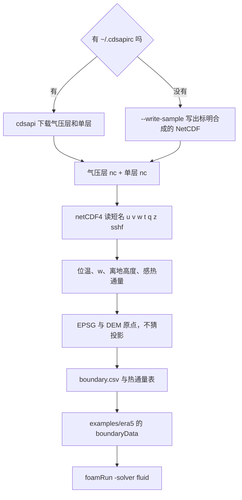
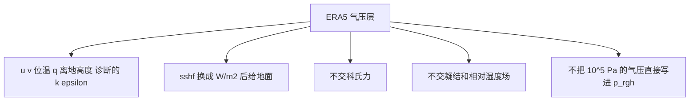
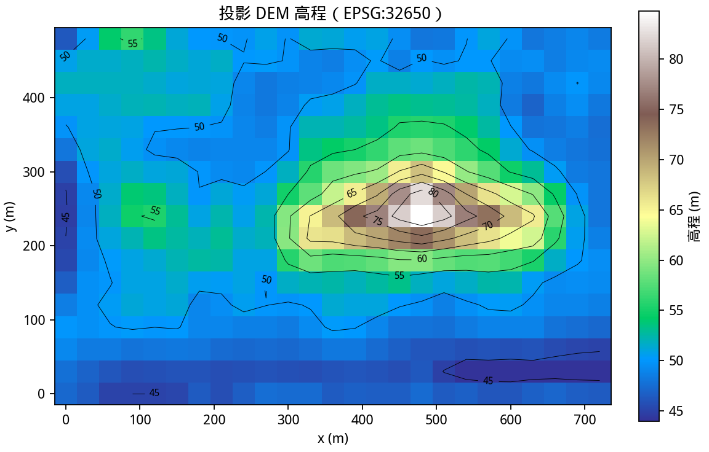
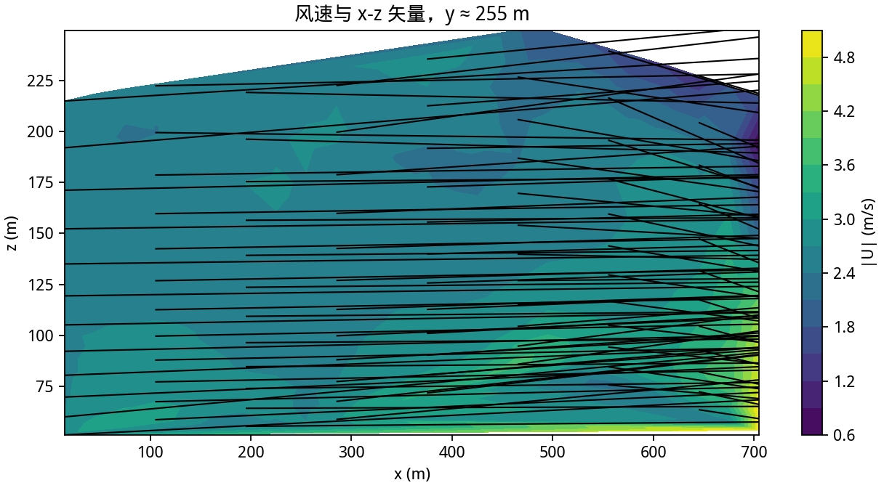
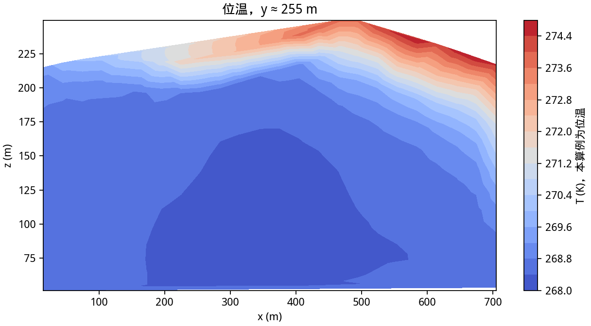
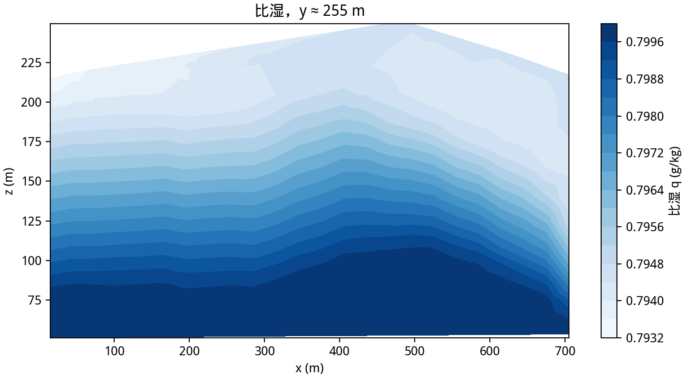
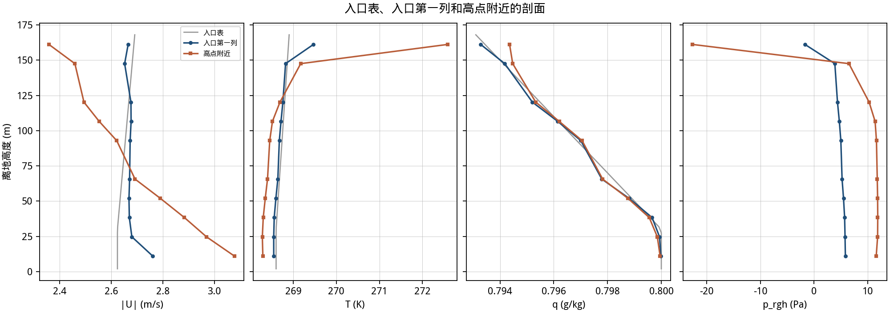

# 第 7 课：用 ERA5 填入口

第 5 课的高空来自 Open-Meteo 的 ICON。ERA5 气压层要 Copernicus CDS 的账号。这个仓库里没有放密钥，Open-Meteo 的 `models=era5` 对气压层变量返回空值，所以本课真正算完的是一份标明合成的 NetCDF。它用 ERA5 的短名和单位。现成算例在 `examples/era5`。



## 7.1 数据放在哪

真下载走 CDS 的 `reanalysis-era5-pressure-levels` 和 `reanalysis-era5-single-levels`。账号写在 `~/.cdsapirc`，不要写进命令行。依赖在 `requirements-era5.txt`。

没有密钥时：

```bash
python3 tools/fetch_era5_boundary.py \
    --write-sample /tmp/era5_sample \
    --station 39.75,116.25 --station 40.00,116.25 \
    --epsg 32650 --z0 0.1 --output /tmp/unused.csv
```

argparse 仍要求 `--station` 与 `--epsg`，也要求 `--z0` 和 `--output`。`--write-sample` 在用到它们之前就返回，并写出两个 nc。仓库里的副本是 `examples/era5/inputs/era5_pressure_sample.nc` 和 `era5_single_sample.nc`。全局属性 `tutorial_sample` 写着 `synthetic ERA5-shaped NetCDF, not a CDS download`。

有密钥时，同一脚本去掉 `--write-sample` 和 `--from-files`，加上 `--date` 和重复的 `--time`。区域按测站经纬度各扩 0.25°。

## 7.2 变量对照

| ERA5 | 单位 | 写进算例 |
|---|---|---|
| `u` `v` | m/s | `U` 的前两个分量 |
| `w`，垂直速度 | Pa/s | `w = -omega / (rho g)`，`rho = p / (R T)`，T 用开尔文 |
| `t` | K，绝对温度 | 换成 1000 hPa 的位温，写入 `T` |
| `q` | kg/kg | 被动标量 `q` |
| `z` | m²/s²，位势 | `(z - z_地面) / g`，得到离地高度 |
| 单层 `z` | m²/s² | 上式里的地面位势 |
| `sshf` | J/m²，向下为正，从起报累积 | 对时间差分再取负，得到进入空气的 W/m² |
| `k` `epsilon` | ERA5 没有 | 用 `--z0` 做对数律诊断 |

OpenFOAM 不读 GRIB，也不读 NetCDF。

## 7.3 解码到边界

`examples/era5/Allrun` 执行的就是下面这一段，测站和原点跟景山 DEM 一致：

```bash
python3 tools/fetch_era5_boundary.py \
    --from-files examples/era5/inputs/era5_pressure_sample.nc \
                 examples/era5/inputs/era5_single_sample.nc \
    --station 39.75,116.25 --station 40.00,116.25 \
    --epsg 32650 --origin-x 447435 --origin-y 4419195 \
    --z0 0.1 \
    --solver-times 0 60 120 \
    --output examples/era5/inputs/boundary.csv
```

`--epsg` 不给就退出。脚本不会按经度挑 UTM 带。两个格点投影后的局部 y 大约是 -18916 m 和 8832 m，都在 480 m 宽的域外面，域内是它们之间的线性插值。`--solver-times` 把文件里的三个小时依次映射到 0 s，然后 60 s，然后 120 s。第 5 课把一个小时写成 180 s。这里用 60 s，是为了把解码到求解的链路跑完。

然后：

```bash
cd examples/era5
./Allrun
```

成功时日志有 `Mesh OK`，求解以单独一行的 `End` 结束。这台机器上 4608 个格子积到 120 s，`ExecutionTime` 是 1.42 s。t = 56 起出现 `bounding k`，上限大约 17 m²/s²，积分没有停。

## 7.4 这张源能交出去什么



能接上的是第 5.2 节那张表里的映射入口、地面热通量和被动比湿。接不上的也相同：没有现成的科氏力 fvModel，比湿不改密度，出口 `p_rgh` 只留 ±5 Pa 的扰动。

## 7.5 容易出错的地方

- 把 Open-Meteo 的 `models=era5` 当成气压层。那些层的返回值是空的，本课才改走 CDS 或合成样本。
- `t` 是绝对温度。直接写进 `Boussinesq` 的 `T`，稳定层结会变成上冷下热的绝对温度递减。
- `w` 的单位是 Pa/s。不换算的话，入口垂直速度会大到每秒几十米的量级。
- `sshf` 向下为正，而且是累积焦耳每平方米。忘记差分、忘记变号，热通量的符号就反了。样本里进入空气的通量大约是 20 W/m²、15 W/m²、8 W/m²。
- 位势高度每个小时不一样。要先在各自的柱上插到离地高度，再在时间之间插值。
- 样本文件的属性写了 synthetic。拿它和 ICON 那次 360 s 的图比天气，比的是格式，不是同一次分析。

## 7.6 这一次的图

下面六张图来自 `examples/era5` 的 t = 120。驱动是合成样本。












`plot_atmospheric.py` 打印：

```text
cells=4608, speed=[0.1895, 6.268] m/s, T=[267.9, 277.4] K, q=[0.000793, 0.0008] kg/kg
```

## 费曼检查

1. 为什么没有 CDS 密钥时，仍可以跑通 `examples/era5/Allrun`？
2. ERA5 的 `t` 和算例里的 `T` 差在哪一次换算？
3. `sshf` 为正，为什么热通量表里仍是正的加热？
4. 两个格点的 y 都在域外，入口面上的风从哪来？
