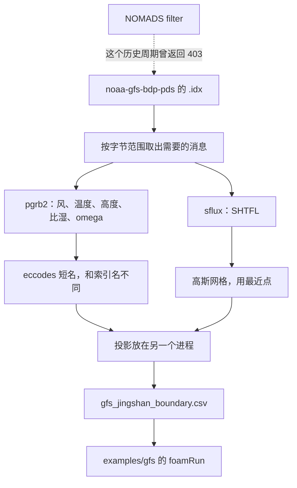
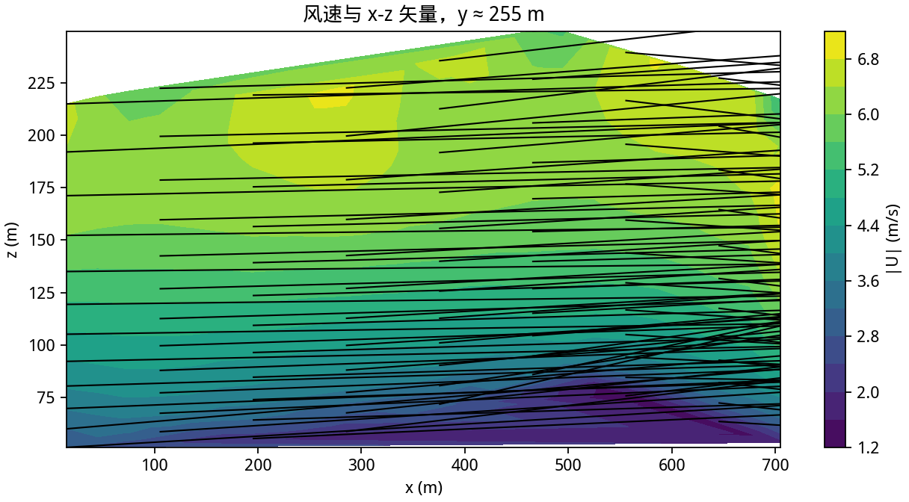
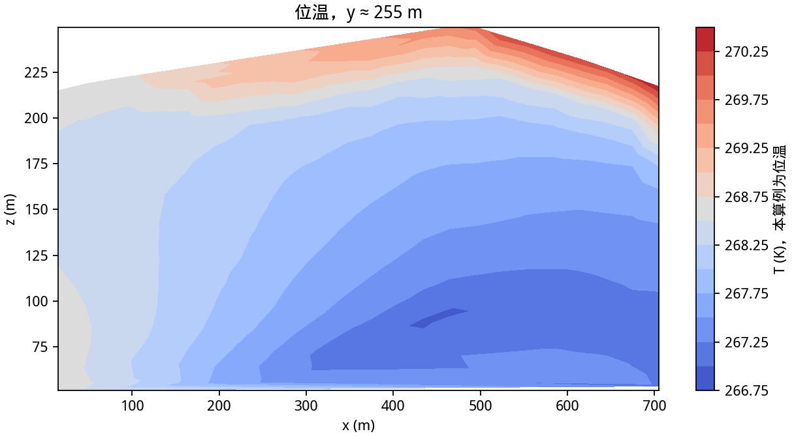
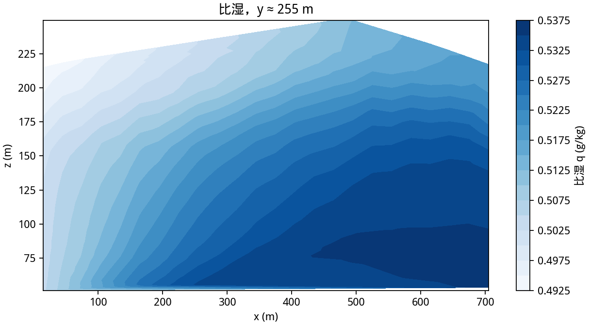
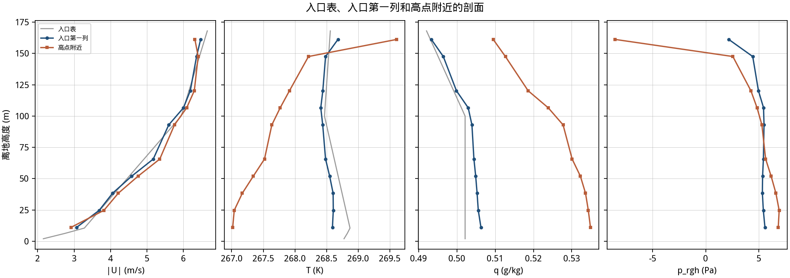

# 第 8 课：用 GFS 填入口

GFS 的 0.25° GRIB2 放在 NOAA 的公开桶里，不需要密钥。本课下载了 2025-01-15 00Z 的 f000 到 f002，解码成小 CSV，在景山网格上积到 120 s。现成算例在 `examples/gfs`。全球文件不进 Git。`downloads/gfs/` 里的子集大约一百多 MB，已经被忽略。



## 8.1 从哪里下

桶的根是 `https://noaa-gfs-bdp-pds.s3.amazonaws.com`。一个时次有两份文件：

```text
gfs.20250115/00/atmos/gfs.t00z.pgrb2.0p25.f000
gfs.20250115/00/atmos/gfs.t00z.sfluxgrbf000.grib2
```

旁边的 `.idx` 给出每条消息的字节偏移。脚本只取下面这些，不拉全球文件。

| 索引里的名字 | 层 | eccodes 短名 |
|---|---|---|
| `UGRD` `VGRD` | 10 m、100 m，以及 1000 到 850 hPa | `10u` `10v`，气压层上是 `u` `v` |
| `TMP` | 2 m、100 m 和那些气压层 | `2t`，气压层上是 `t` |
| `HGT` | 地面和气压层 | 地面 `orog`，气压层 `gh` |
| `SPFH` | 2 m 和气压层 | `2sh` 和 `q` |
| `VVEL` | 气压层 | `w`，单位仍是 Pa/s |
| `PRES` | 地面 | `sp` |
| `SHTFL` | 地面，在 sflux 文件 | `ishf` |

NOMADS 的 `filter_gfs_0p25.pl` 对 2025-01-15 返回过 HTTP 403。近期周期可以再试 NOMADS。这个历史周期以 AWS 为准。

依赖写在 `requirements-gfs.txt`。解码用 eccodes（库由 ecmwflibs 带上），投影用 rasterio。cfgrib 不在这条路径里。

## 8.2 单位和缺测

GFS 的 `TMP` 是绝对温度，写入 `T` 之前换成 1000 hPa 位温。`VVEL` 用 `w = -omega / (rho g)`。2 m 风没有单独的消息，用 10 m 风和 `z0 = 0.1 m` 做对数缩小。GFS 没有 10 m 温度，10 m 的温度抄 2 m。100 m 的比湿抄 2 m 的比湿。`k` 和 `epsilon` 用对数律诊断。

`ishf` 是瞬时 W/m²，向上为正，可以直接当 `externalTemperature` 的 `q`。f000 在请求点附近是 4 W/m²，f001 是 30 W/m²，f002 是 53 W/m²。

气压层的 `w` 只在那些 hPa 层上有。2 m 和 10 m 的垂直速度写成 0，100 m 也写成 0。

缺测不能用一个很小的阈值去砍。这条 GRIB 的 `missingValue` 可以是几千，而地面气压大约是 10⁵ Pa。以前用 `0.9 * missingValue` 把 103118 Pa 砍成了 NaN，`0/T` 里出现 `nan`，`foamRun` 直接停。现在只把绝对值大于 10¹⁰ 的数当成缺测。

eccodes 和 rasterio 各带一份 PROJ。同一个进程里先解码再投影，会在 CRS 错误之后 `free(): invalid pointer`。投影改到一个新的 Python 进程，CRS 仍是命令行上的 EPSG。

## 8.3 这一次的命令

`examples/gfs/inputs/boundary.csv` 已经是解码结果。重新下载用：

```bash
python3 tools/fetch_gfs_boundary.py \
    --date 2025-01-15 --cycle 00 \
    --forecast-hour 0 --forecast-hour 1 --forecast-hour 2 \
    --solver-times 0 60 120 \
    --lat 39.923 --lon 116.389 \
    --epsg 32650 --origin-x 447435 --origin-y 4419195 \
    --z0 0.1 \
    --output tutorial/data/gfs_jingshan_boundary.csv
```

请求点落到两个 0.25° 格点：39.75°N、116.50°E，局部 y 约 -19065 m。40.00°N、116.50°E，局部 y 约 8682 m。两点都在 480 m 的域外，入口是它们的线性插值。

f002 是 02:00 UTC，当地大约 10:00。南格点最低 300 m 的位温从 2 m 的 267.58 K 降到约 249 m 的 267.44 K。北格点从 269.30 K 降到 269.20 K。地面热通量是正的。冬季早晨、近地面加热，出现薄的超绝热层说得通。脚本把原来的硬错误改成警告，两行都留下。`examples/gfs/Allrun` 用的就是留下之后的 CSV。

```bash
cd examples/gfs
./Allrun
```

4608 个格子，120 s，`ExecutionTime` 1.45 s。日志有 `Mesh OK` 和单独一行 `End`。t = 36 时 `k` 被裁到约 2.5×10³ m²/s²。t = 120 时裁剪上限 29 m²/s²，求解没有停。

## 8.4 能交出去什么，交不出去什么

能交的是水平风和由 omega 换来的 `w`。位温和比湿也能交。`k` 与 `epsilon` 是诊断值。地面感热通量向上为正，可以直接用。

交不出去的包括：GFS 辐射场并不进 `radiationModels`。没有科氏力 fvModel。比湿仍是被动标量。sflux 里的其他通量，潜热、降水，这个算例没有对应的边界。高斯网格上的 `ishf` 不能用规则经纬网那套下标去读，要用 `codes_grib_find_nearest`。

## 8.5 容易出错的地方

- 索引名和 eccodes 短名不是同一套。按 `UGRD` 去 `codes_get(shortName)` 会落空。按 `TMP` 选字节范围才是对的，解码后要找 `t` 或 `2t`。
- f002 的位温略降。删掉这一小时，02Z 的加热就没有了。警告留在 stderr，CSV 仍写出 48 行。
- 已有的非空 GRIB 子集会被跳过。第一次下坏了要手动删 `downloads/gfs/` 里那个文件。
- 10 m 温度是抄来的 2 m 温度。不要把它写成 GFS 的 10 m 产品。

## 8.6 这一次的图

图来自真实的 2025-01-15 00Z 周期，t = 120，也就是 f002。










```text
cells=4608, speed=[1.132, 7.362] m/s, T=[266.1, 271.2] K, q=[0.0004917, 0.000554] kg/kg
```

位温的全场范围比 f002 那 0.1 K 的近地下降更宽。下降留在边界表里。图上的宽度还包含求解自己的尾部，和第 5 课 360 s 积分里看到的尾部是同一类现象。

## 费曼检查

1. 为什么脚本读 `.idx`，而不是把 `pgrb2.0p25` 整份下下来？
2. `SHTFL` 和 `ishf` 是什么关系，符号怎样用？
3. f002 位温随高度下降时，为什么不把这一小时丢掉？
4. 投影为什么要新开一个 Python 进程？
