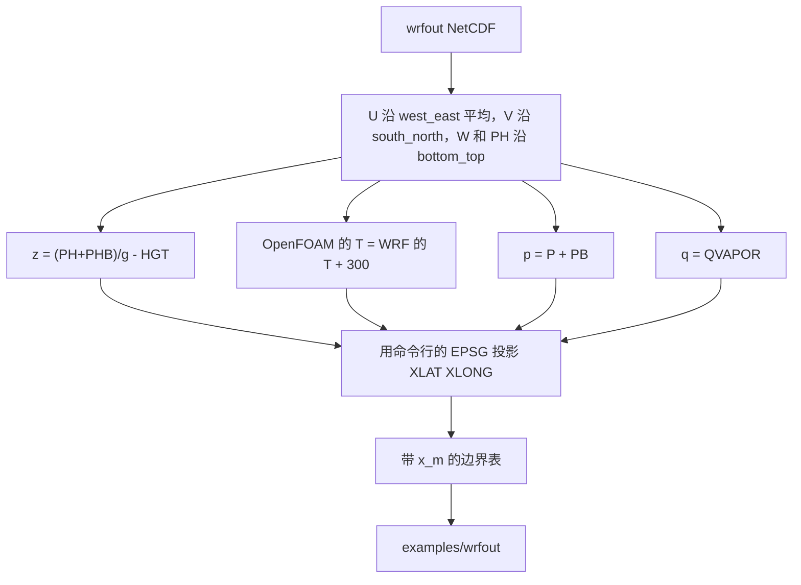
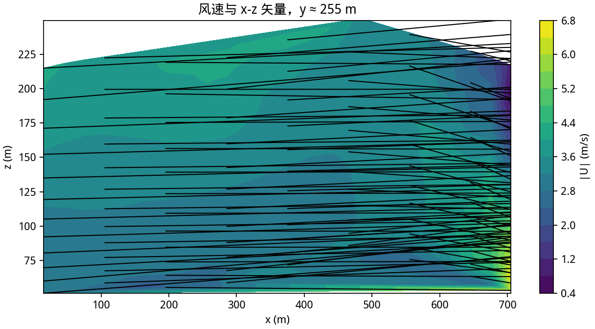
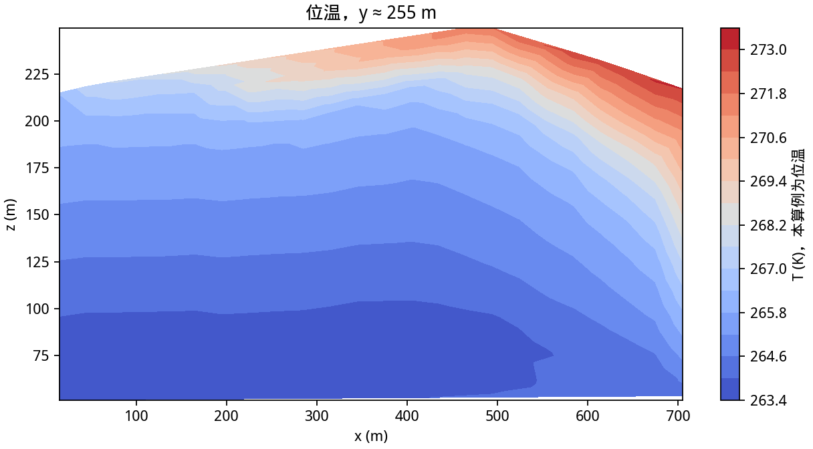
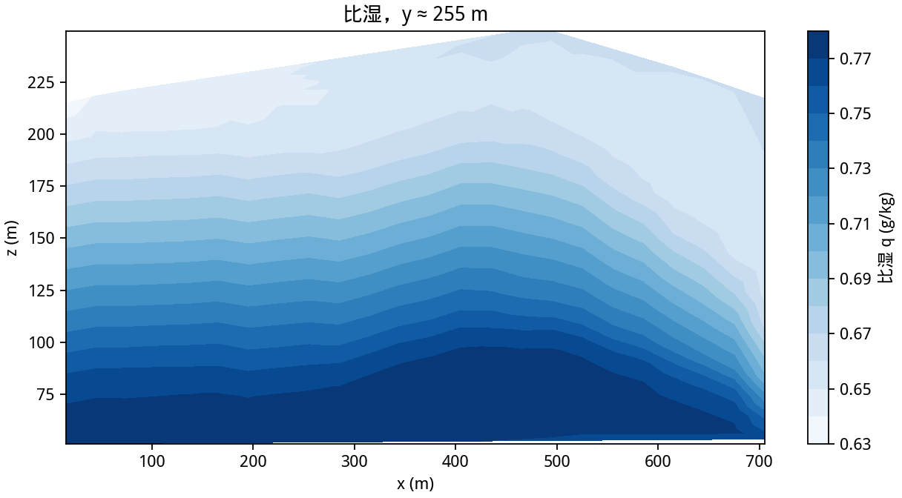
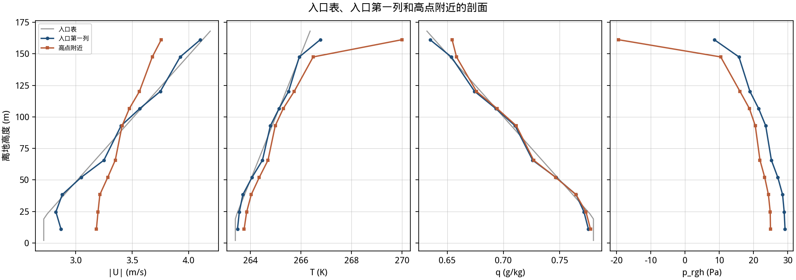

# 第 9 课：用 WRF 的 wrfout 填入口

WRF 把风和垂直速度放在错开的面上。位温存的是相对 300 K 的扰动。高度在 `PH` 和 `PHB` 里。本课不依赖 wrf-python，在 `tools/wrfout_to_boundary.py` 里把相邻两个面平均到质量点。

没有找到一份小的公开 `wrfout` 可以提交。仓库里的文件是合成的，属性写着 `synthetic wrfout-format NetCDF, not a WRF forecast`。现成算例在 `examples/wrfout`。你自己的预报把路径换掉即可，投影参数仍要自己给。



## 9.1 样本里有什么

`examples/wrfout/inputs/wrfout_d01_synthetic.nc`：

| 项 | 值 |
|---|---|
| 质量点 | 5 × 4 × 5 |
| `DX` `DY` | 150 m、120 m |
| 时间 | 两个，标签写成 2025-01-15 00:00 和 01:00 |
| `HFX` | 域平均 18 W/m²，然后 10 W/m²，向上为正 |
| 经纬度 | 由 EPSG:32650 和 DEM 原点反算，局部 x 回到 0、150、300 这种间距 |

`MAP_PROJ`、`TRUELAT1` 这些网格参数不读。换投影要改命令行的 `--epsg`，不能指望文件里的地图投影整数。

依赖写在 `requirements-wrf.txt`。读文件用 netCDF4，投影用 rasterio。

## 9.2 变量对照

| wrfout | 处理后 | 算例 |
|---|---|---|
| `U` `V` `W` | 两个错位面的平均 | `U` |
| `PH` `PHB` `HGT` | `(PH+PHB)/g - HGT` | 离地高度 `z_m` |
| `T` | 加 300 | 位温，直接写入 `T`。WRF 的 `T` 已经是扰动位温 |
| `P` `PB` | 相加 | `p_Pa`，出口再收成 `p_rgh` |
| `QVAPOR` | 原样 | 比湿 `q` |
| `HFX` | 域平均 | 地面热通量，向上为正 |
| `XLAT` `XLONG` | 指定 EPSG | `x_m` `y_m` |
| `k` `epsilon` | 没有 | 用 `--z0` 诊断，本课 0.1 m |

表里有 `x_m` 时，入口按水平位置做双线性插值。样本的点铺在域内，所以山前的面能读到不同的列。第 5 课的 ICON 两站没有 `x_m`，只沿 y 插值。

## 9.3 命令

重写样本：

```bash
python3 tools/wrfout_to_boundary.py \
    --write-sample examples/wrfout/inputs/wrfout_d01_synthetic.nc \
    --epsg 32650 --origin-x 447435 --origin-y 4419195
```

解码并求解：

```bash
cd examples/wrfout
./Allrun
```

`Allrun` 使用 `--solver-times 0 120`。文件里只有两个时刻，个数必须相同。4608 个格子积到 120 s，`ExecutionTime` 1.42 s，`Mesh OK`，单独一行 `End`。

t = 22 时 `k` 被裁到约 2.1×10⁵ m²/s²，t = 40 和 t = 56 还有裁剪。t = 120 的日志已经不再裁 `k`。求解没有停。

自己的文件：

```bash
python3 tools/wrfout_to_boundary.py \
    --wrfout /path/to/wrfout_d01_2025-01-15_00:00:00 \
    --epsg 32650 --origin-x 447435 --origin-y 4419195 \
    --z0 0.1 \
    --solver-times 0 180 360 \
    --output tutorial/data/my_wrf_boundary.csv
```

`--solver-times` 的个数等于文件里的时间层数。上面三格只是例子。你的文件有几个 `Times`，就写几个秒。

## 9.4 能交出去什么

能交出去的量就是上一节那张表。地面热通量用域平均的 `HFX`。

WRF 的地图投影整数留在文件里，脚本不读。土地类型和水成物也留在文件里。`QRAIN` 与 `QCLOUD` 不进这个算例。扰动位温如果忘记加 300，`T` 会落在 0 K 附近，`Boussinesq` 立刻不成立。样本的 `T` 在文件里大约是 -37 到 -33，加上 300 之后才是 263 K 到 267 K 这一档。

## 9.5 容易出错的地方

- 用未消错位的 `U` 当质量点的风。最东边多出来的那个面不属于任何质量点。
- 把 `PH` 当成几何高度。它是位势，要除以 `g`，还要减去 `HGT` 才是离地高度。
- 相信 `MAP_PROJ`。脚本明确忽略它。投影只认 `--epsg` 和原点。
- 把合成文件当成 2025-01-15 的预报。属性里的 synthetic 就是为了拦住这件事。

## 9.6 这一次的图

图由合成 wrfout 驱动，t = 120。










```text
cells=4608, speed=[0.4241, 7.387] m/s, T=[263.4, 273.4] K, q=[0.0006306, 0.0007798] kg/kg
```

## 费曼检查

1. WRF 文件里的 `T` 为什么要加 300 才写入 OpenFOAM？
2. `U` 的维度比质量点多 1，多在哪一条轴上？
3. 样本的经纬度从哪来，为什么不读 `MAP_PROJ`？
4. 表里出现 `x_m` 之后，入口插值和第 5 课的两站插值有什么差别？
