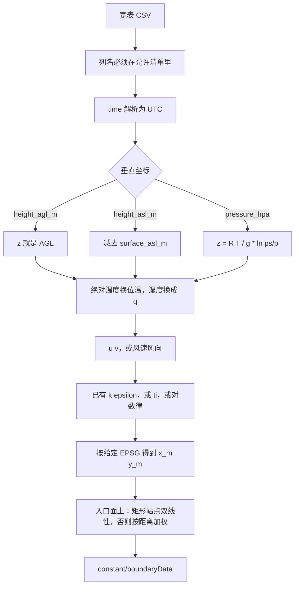
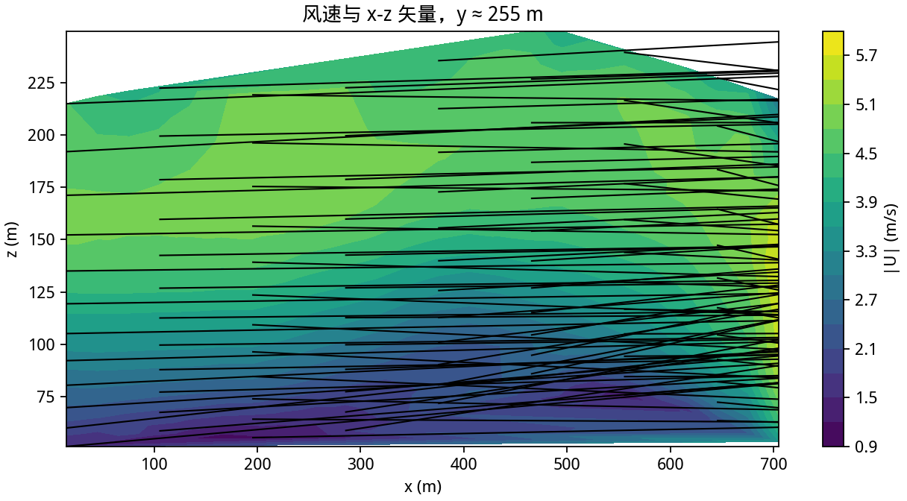
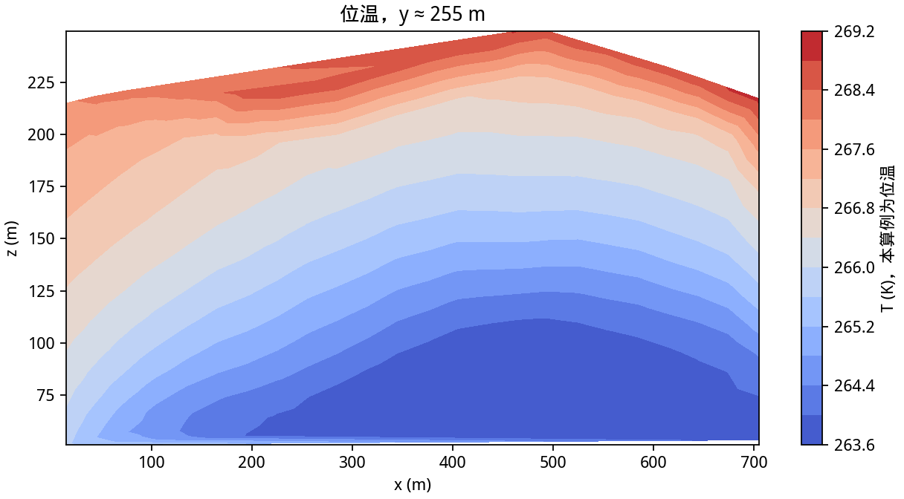
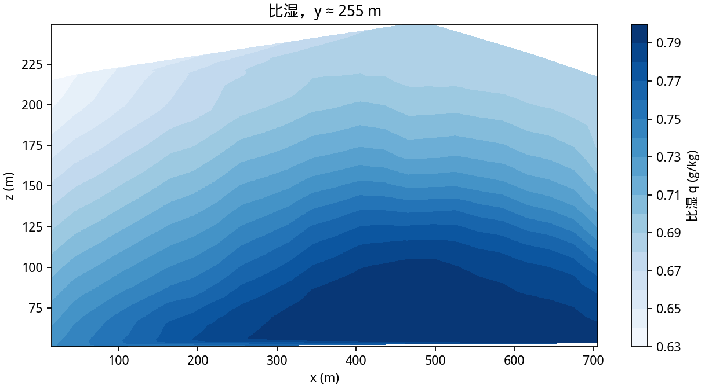
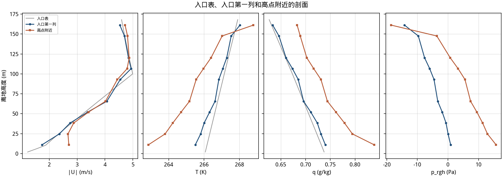

# 第 10 课：用自己填的观测宽表

前三课的输入是模式文件。这一课的输入是一张 CSV。每一行是某站在某时刻的一个高度。`tools/csv_obs_to_boundary.py` 检查列名和单位，再写成第 5 课用的边界表。现成算例在 `examples/csv_obs`。

填好的例子 `inputs/jingshan_obs_example.csv` 从景山的 ICON 和 ZBAA 表改写，文件头写着 EXAMPLE。空表是 `inputs/obs_template.csv`。



## 10.1 列

全表用同一种垂直坐标，同一种温度列，同一种湿度列。空单元格是缺测。写成 `nan`、`na` 或 `null` 会报错，行不会被悄悄丢掉。报错信息带文件行号。

| 列 | 是否必填 | 单位和规则 |
|---|---|---|
| `id` | 必填 | ASCII，不能有空格。同一个 id 的经纬度必须相同 |
| `time` | 必填 | UTC，例如 `2025-01-15T00:00:00Z`。没有时区就拒绝 |
| `lat` `lon` | 必填 | WGS84 的度。投影靠命令行的 `--epsg` `--origin-x` `--origin-y` |
| `height_agl_m` | 三种垂直坐标里选一种 | 离地米。必须 ≥ 0.5，否则对数律在 z = 0 除零 |
| `height_asl_m` | 同上 | 海拔米。同一行还要 `surface_asl_m`。离地高度是二者之差 |
| `pressure_hpa` | 用气压当高度时必填。已有高度时可以另给气压 | hPa，100 到 1100。当高度用时还要 `surface_pressure_hpa` |
| `surface_pressure_hpa` | 气压当高度时必填 | 离地高度 `z = (R T / g) ln(ps / p)`。T 用这一层的绝对温度，是等温一步，不是整层积分 |
| `t_c` | 三选一，全表同一列 | 摄氏绝对温度 |
| `t_k` | 同上 | 开尔文绝对温度 |
| `theta_k` | 同上 | 已经是位温。只有它、又只有气压、没有绝对温度时，不能把气压换成高度 |
| `u_ms` `v_ms` | 与下面的风速风向二选一 | m/s，向东、向北为正。两套都填会报错 |
| `wind_speed_ms` `wind_dir_deg` | 与 u v 二选一 | 风向是来向，正北为 0，顺时针 |
| `w_ms` | 可空 | 空着按 0 |
| `q_kgkg` | 湿度三选一 | kg/kg，允许 0 到 0.05 |
| `rh_percent` | 同上 | 0 到 100。需要绝对温度和气压，用 Bolton 公式 |
| `dewpoint_c` | 同上 | 露点摄氏。水汽压取露点的饱和水汽压，再换成比湿。需要气压 |
| `k_m2s2` `epsilon_m2s3` | 成对出现，或都空 | 只填一个会报错 |
| `ti` | 可空 | 湍流强度，必须是分数。0.12 表示 12%。大于等于 1 会拒绝。`k = 1.5 (ti U)^2`，混合长 `kappa (z+z0)`，`epsilon = Cmu^0.75 k^1.5 / l` |
| `z0_m` | 要诊断湍流时必填 | 同一个 id 一个正值。只参与 `k` 和 `epsilon`。地面 `Ks` 仍来自 `landcover_z0.csv` |
| `heat_flux_wm2` | 必填 | W/m²，正值加热空气。同一时刻所有行必须是同一个数。这个算例的地面通量是一张时间表，不是每个面一个值 |

至少两个高度，同一个 id、同一个时刻。`--solver-times` 的个数等于不同的 UTC 时刻，从早到晚一一对应。

没有 `pressure_hpa` 时，气压按 `p = ps exp(-g z / (R T))` 补上。连 `surface_pressure_hpa` 也没有，就用 101325 Pa 当 `ps`，并在 stderr 警告一次。位温随高度在最低 300 m 里下降时同样只警告，行保留。

## 10.2 站怎样落到入口上

每个 id 投影一次，得到 `x_m` 和 `y_m`。命令里的 EPSG 缺了就退出，脚本不猜带号。

站点若正好组成经纬度矩形，入口面上用双线性。两个站若在同一条经线上，UTM 东坐标仍会差几十米，拼不成矩形。这时按水平距离加权，再在每个柱内按离地高度线性插值。高度或时间超出表格时，用边上的值。

景山例子的南站局部坐标大约是 x = -785 m，y = -5125 m。北站大约是 x = -882 m，y = 8749 m。两点都在 720 m × 480 m 的域外。域内的入口是这两柱的距离加权。

`z0_m` 不写进 `nut` 的 `Ks`。地面粗糙度仍是 WorldCover 那张表。观测里的 `z0_m` 只给对数律。

## 10.3 例子和命令

例子的 `t_c` 由第 5 课边界表里的位温和气压反算。转回去之后，南站 2 m、00:00 UTC 的位温仍是 263.096 K。00:00 UTC 的热通量仍是 21.755 W/m²，01:00 UTC 是 12.411 W/m²，02:00 UTC 是 2.435 W/m²。

```bash
python3 tools/csv_obs_to_boundary.py \
    --input examples/csv_obs/inputs/jingshan_obs_example.csv \
    --output examples/csv_obs/inputs/boundary.csv \
    --epsg 32650 --origin-x 447435 --origin-y 4419195 \
    --solver-times 0 60 120

cd examples/csv_obs
./Allrun
```

`Allrun` 把三个 UTC 小时依次映射到 0 s，然后 60 s，然后 120 s。第 5 课用 180 s 表示一个小时，那个长积分在 `examples/jingshan_openmeteo`。这里 120 s 用来确认宽表能进求解器。

4608 个格子，`ExecutionTime` 1.43 s，`Mesh OK`，单独一行 `End`。t = 36 时 `k` 被裁到约 2.5×10⁴ m²/s²。t = 120 时裁剪上限 6.43 m²/s²。

空模板只有表头和注释。拿去转换会得到 `no data rows`。先抄表头，再填至少两层。

依赖和地形课相同：`numpy`、`rasterio`。没有新的包。

## 10.4 这张表能驱动什么

能驱动的就是第 5 课已经接上的那些边界。入口和两个侧面给 `U` 与标量。出口给 `p_rgh`。地面给一条随时间变化的热通量。

表里没有对应边界的量不要加列。未知列名会整表拒绝，避免把 `wd` 当成没读到的风向。相对湿度只在预处理里变成比湿，求解器不保存 `rh`。露点同样。湍流强度只在预处理里变成 `k` 和 `epsilon`。

## 10.5 容易出错的地方

- 时间写成 `2025-01-15 08:00` 且不带 `Z`。那是本地时还是 UTC，脚本无法判断，所以直接拒绝。
- 0 m 的地面行。离地高度必须 ≥ 0.5 m。地面气压放在 `surface_pressure_hpa`，不要当成一个剖面层。
- 同一时刻两个站的热通量不同。算例只有一条地面通量曲线。先决定用哪一个值，再把所有行写成它。
- `ti` 写成 12 而不是 0.12。大于等于 1 的值会被拒绝。
- 既填 `u_ms` 又填 `wind_speed_ms`。脚本不挑选其中一套。
- 忘记 `--epsg`。经纬度不会被当成米。

## 10.6 这一次的图

图用的是标明 EXAMPLE 的景山宽表，t = 120。天气内容和第 5 课相同，时钟更短，所以这不是第 6 课那张 360 s 的图。










```text
cells=4608, speed=[0.3795, 7.335] m/s, T=[252.7, 276.5] K, q=[0.0006282, 0.001346] kg/kg
```

位温 252.7 K 和比湿 1.35 g/kg 是全场两端。入口表本身仍是 263 K 附近、约 0.8 g/kg 的冬夜柱。两端和第 5 课长积分里的尾部一样，比地面热通量能造成的升温大。

## 费曼检查

1. 为什么 `nan` 不能留在单元格里代表缺测？
2. 同一条经线上的两个站，为什么不能假设它们的 `x_m` 相等？
3. `z0_m` 填了 0.1，地面 `Ks` 为什么还会沿用 WorldCover？
4. `heat_flux_wm2` 为什么要求同一时刻只有一个数？
